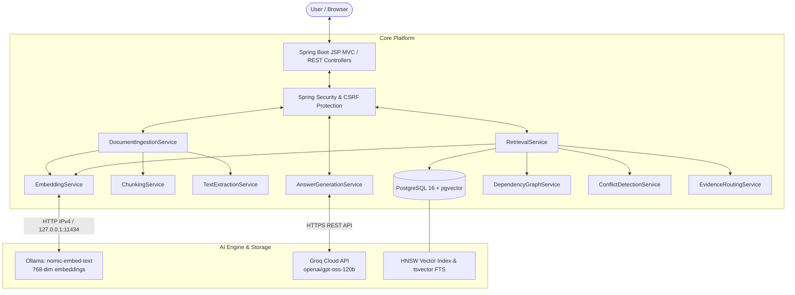
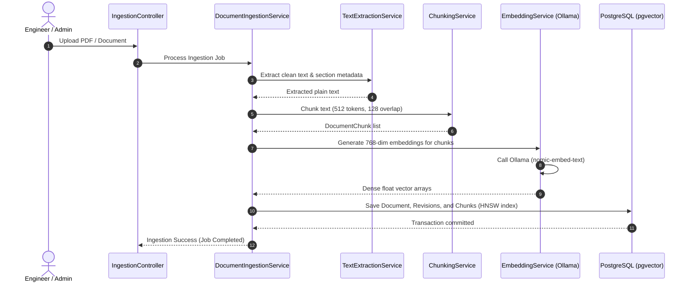
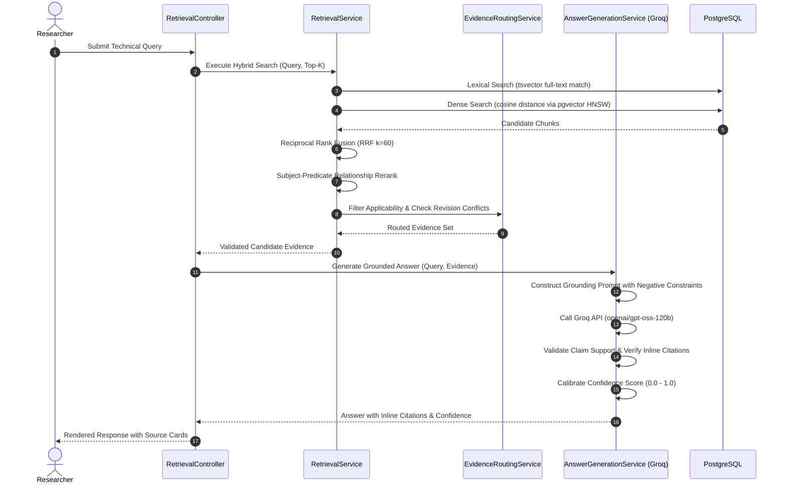

# SpaceDoc Intelligence: ISRO Technical Document RAG

SpaceDoc Intelligence is a research-driven, production-grade Retrieval-Augmented Generation (RAG) platform designed for technical, mission-critical, and scientific documents. It implements **revision-aware evidence routing**, **hybrid retrieval (dense vector + lexical FTS)**, **subject-predicate relationship reranking**, **grounded citation verification**, and **conflict detection** across document iterations.

---

## Architecture Overview

SpaceDoc Intelligence combines a local, privacy-preserving embedding pipeline with Groq Cloud's ultra-low-latency LPU inference for factual, hallucination-resistant answer generation.

### System Architecture



---

## Core Retrieval & RAG Workflows

### 1. Document Ingestion Flow



### 2. RAG Question Answering Flow



---

## Technology Stack & Component Roles

| Layer / Technology | Component | Exact Role in SpaceDoc Intelligence |
|---|---|---|
| **Language & Framework** | Java 21+ / Spring Boot 3.3.0 | Core backend platform, dependency injection, REST endpoints, transaction management. |
| **Packaging** | Apache Maven (WAR packaging) | Build automation, dependency management, and deployable WAR artifact creation. |
| **Presentation Layer** | JSP, JSTL, Bootstrap, Vanilla JS | Interactive web UI for search, research assistant, document upload, and impact visualization. |
| **Relational & Vector DB** | PostgreSQL 16 + `pgvector 0.8.x` | Relational document metadata, full-text search (`tsvector`), and 768-dim vector cosine similarity with HNSW indexing. |
| **Database Migrations** | Flyway | Versioned SQL migrations (`V1__initial_schema.sql`, `V2__update_vector_dimension_768.sql`). |
| **Local Vector AI** | Ollama (`nomic-embed-text`) | Private local embedding generation (768 dimensions) over IPv4 (`127.0.0.1:11434`). |
| **Cloud Generation AI** | Groq Cloud API | High-speed LPU inference engine running `openai/gpt-oss-120b` for factual, grounded technical answer generation. |
| **Security Layer** | Spring Security 6 | Role-based authentication, CSRF token validation, HTTP-only secure cookie sessions. |
| **Automated Testing** | JUnit 5 & Mockito | 95 regression tests covering ingestion, chunking, retrieval, routing, conflict detection, and answer generation. |

---

## Package Structure

```
com.spacedoc
├── SpaceDocIntelligenceApplication.java   # Spring Boot entry point (SpringBootServletInitializer)
├── config/
│   ├── SecurityConfiguration.java         # Spring Security, CSRF, and session filters
│   └── VectorUserType.java                # Hibernate custom user type for pgvector
├── controller/
│   └── PageController.java                # MVC view controller routing to JSP templates
├── dto/
│   ├── DocumentDTO.java                   # Document metadata transfer
│   ├── ImpactAnalysisDTO.java             # Impacted document and dependency payload
│   ├── IngestionRequestDTO.java           # Document upload request data
│   ├── IngestionResponseDTO.java          # Ingestion status and summary
│   ├── QueryRequestDTO.java               # Question answering query parameters
│   └── RetrievalResultDTO.java            # Ranked evidence chunk with score and provenance
├── entity/
│   ├── Document.java                      # JPA entity for technical documents
│   ├── DocumentChunk.java                 # Text chunks with 768-dim vector embeddings
│   ├── DocumentRelationship.java          # Graph edge (DEPENDS_ON, SUPERSEDES, etc.)
│   ├── DocumentRevision.java              # Document revisions and change tracking
│   ├── IngestionJob.java                  # Asynchronous ingestion job records
│   ├── Requirement.java                   # Extracted engineering requirements
│   └── TechnicalEntity.java               # Extracted mission systems and components
├── exception/
│   ├── GroqException.java                 # Groq API client exceptions
│   ├── IngestionException.java            # Document ingestion and parsing errors
│   └── SpaceDocException.java             # Base system runtime exception
├── repository/
│   ├── DocumentChunkRepository.java       # Native SQL for pgvector HNSW and tsvector FTS
│   ├── DocumentRepository.java            # Document metadata queries
│   ├── DocumentRevisionRepository.java    # Revision history and status queries
│   └── IngestionJobRepository.java        # Background job status queries
├── rest/
│   ├── DocumentController.java            # Document CRUD and metadata API
│   ├── ImpactAnalysisController.java      # Dependency impact analysis API
│   ├── IngestionController.java           # PDF / text ingestion endpoints
│   ├── RetrievalController.java           # Hybrid search & question-answering API
│   └── SystemHealthController.java        # Health check and dependency status endpoint
└── service/
    ├── AnswerGenerationService.java       # Groq client, prompt engineering, citation validation
    ├── ChunkingService.java               # Sliding-window token-based document segmenter
    ├── ConflictDetectionService.java      # Contradiction detection across revisions
    ├── DependencyGraphService.java        # Graph traversal across technical requirements
    ├── DocumentIngestionService.java      # Pipeline orchestrator for uploaded documents
    ├── EmbeddingService.java              # Ollama client with IPv4 normalization
    ├── EvaluationService.java             # RAG evaluation runner (MRR, precision, validity)
    ├── EvidenceRoutingService.java        # Revision-aware routing controller
    ├── ImpactAnalysisService.java         # Downstream change impact analyzer
    ├── RetrievalService.java              # Hybrid search & subject-predicate reranker
    ├── RevisionComparisonService.java     # Deterministic text comparison across versions
    └── TextExtractionService.java         # Apache Tika/PDF text extraction
```

---

## Environment Configuration

The application reads configuration from environment variables or a `.env` file in the project root.

### Sample Configuration (`.env.example`)

Copy `.env.example` to `.env` and fill in your values:

```bash
cp .env.example .env
```

```properties
# ============================================================================
# DATABASE CONFIGURATION
# ============================================================================
DB_HOST=localhost
DB_PORT=5432
DB_NAME=spacedoc
DB_USER=spacedoc
DB_PASSWORD=spacedoc_local_dev_password
JDBC_URL=jdbc:postgresql://${DB_HOST}:${DB_PORT}/${DB_NAME}
PGVECTOR_DIMENSION=768

# ============================================================================
# GROQ API CONFIGURATION (Answer Generation)
# ============================================================================
GROQ_API_KEY=your_groq_api_key_here
GROQ_MODEL=openai/gpt-oss-120b
GROQ_BASE_URL=https://api.groq.com/openai/v1

# ============================================================================
# OLLAMA CONFIGURATION (Embeddings Only)
# ============================================================================
OLLAMA_BASE_URL=http://localhost:11434
OLLAMA_EMBEDDING_MODEL=nomic-embed-text

# ============================================================================
# APPLICATION SECURITY & SERVER
# ============================================================================
SERVER_PORT=8080
ADMIN_USERNAME=admin
ADMIN_PASSWORD=admin_local_dev_password
SECRET_KEY=local-dev-secret-key-change-in-production
```

> **SECURITY NOTICE:** Never commit `.env` or real API keys to version control. The repository `.gitignore` strictly ignores `.env`, `logs/`, `*.log`, and `target/`.

---

## Quick Start & Installation

### Prerequisites

1. **Java Development Kit (JDK):** Version 21 or higher.
2. **Apache Maven:** Version 3.8 or higher.
3. **PostgreSQL 16+ with pgvector:** Available via Docker or local installation.
4. **Ollama:** Running locally with the `nomic-embed-text` model pulled.
5. **Groq API Key:** Available from [console.groq.com](https://console.groq.com/keys).

---

### Step 1: Start PostgreSQL with pgvector

You can start the preconfigured container using Docker Compose:

```bash
docker-compose up -d
```

Or manually connect to an existing PostgreSQL 16 instance and enable pgvector:
```sql
CREATE EXTENSION IF NOT EXISTS vector;
```

---

### Step 2: Start Ollama and Pull the Embedding Model

Start Ollama in a separate terminal:
```bash
ollama serve
```

Pull the required 768-dimensional embedding model:
```bash
ollama pull nomic-embed-text
```

---

### Step 3: Run the Application (Windows PowerShell)

SpaceDoc Intelligence provides a comprehensive PowerShell startup script `run_app.ps1` that performs automated pre-flight checks:
- Verifies PostgreSQL (port 5432) TCP readiness
- Verifies Ollama (port 11434) TCP readiness
- Verifies `GROQ_API_KEY` presence in `.env`
- Sets environment variables and launches via Maven

Execute the script:
```powershell
powershell -ExecutionPolicy Bypass -File run_app.ps1
```

Alternatively, run manually via Maven:
```powershell
$env:GROQ_API_KEY = "your_actual_groq_api_key"
$env:GROQ_MODEL = "openai/gpt-oss-120b"
mvn spring-boot:run
```

---

## Usage Instructions

### Web User Interface

Open your browser and navigate to:
```
http://localhost:8080
```

- **Login:** Enter credentials (`admin` / `admin_local_dev_password` by default).
- **Dashboard (`/dashboard`):** Real-time metrics on ingested documents, chunks, and system health.
- **Research Assistant (`/research-assistant`):** Natural language technical query interface with grounded answers, inline citations `[Source N]`, and confidence metrics.
- **Ingestion Centre (`/ingestion-centre`):** Upload technical PDF files or ISRO web documentation for automated chunking and embedding.
- **Document Library (`/document-library`):** Inspect ingested documents, revisions, and extracted requirement entities.
- **Document Detail (`/document-detail?id={id}`):** View full document hierarchy, revision change points, and dependencies.

### Key REST Endpoints

| Endpoint | Method | Description |
|---|---|---|
| `/api/system/health` | `GET` | System health check reporting database and version status. |
| `/api/retrieval/ask` | `POST` | Ask a technical question; returns answer, citations, and confidence. |
| `/api/retrieval/search` | `POST` | Execute hybrid search; returns ranked document chunks with similarity scores. |
| `/api/ingestion/upload` | `POST` | Upload and ingest a PDF document. |
| `/api/impact/analyze` | `POST` | Perform impact analysis on document revisions and technical entities. |

---

## Testing & Quality Assurance

### Execute Regression Test Suite
SpaceDoc Intelligence includes 95 automated regression tests:

```bash
mvn clean test
```

Expected output:
```
[INFO] Results:
[INFO] Tests run: 95, Failures: 0, Errors: 0, Skipped: 0
[INFO] BUILD SUCCESS
```

### Build Production WAR Artifact
```bash
mvn package -DskipTests
```
The deployable WAR is generated at:
```
target/spacedoc-intelligence-1.0.0-SNAPSHOT.war
```

---

## Troubleshooting

### 1. Ollama IPv6 `Connection refused` on Windows
- **Cause:** Windows resolves `localhost` to IPv6 `[::1]`, but Ollama binds to IPv4 `127.0.0.1`.
- **Solution:** SpaceDoc's `EmbeddingService` automatically maps `localhost` and `[::1]` to `127.0.0.1`. Ensure `OLLAMA_BASE_URL=http://127.0.0.1:11434` is used.

### 2. PostgreSQL Vector Dimension Mismatch
- **Cause:** The embedding vector dimension must match the database column dimension (768 for `nomic-embed-text`).
- **Solution:** Flyway migration `V2__update_vector_dimension_768.sql` automatically alters the column to `vector(768)`. Ensure the database user has schema modification permissions.

### 3. Groq API Authorization or Rate Limits
- **Cause:** Missing or expired `GROQ_API_KEY`.
- **Solution:** Ensure a valid key is set in `.env` without surrounding quotes or spaces. Check your active quota at [console.groq.com](https://console.groq.com).

### 4. Port Conflicts (8080, 5432, 11434)
- **Check active port listeners in PowerShell:**
  ```powershell
  Get-NetTCPConnection -LocalPort 8080, 5432, 11434 -State Listen
  ```
- **Change application port:** Set `SERVER_PORT=8081` in `.env` or pass `-Dserver.port=8081` to Maven.

---

## License

Internal research and engineering platform for ISRO technical document analysis. All rights reserved.
